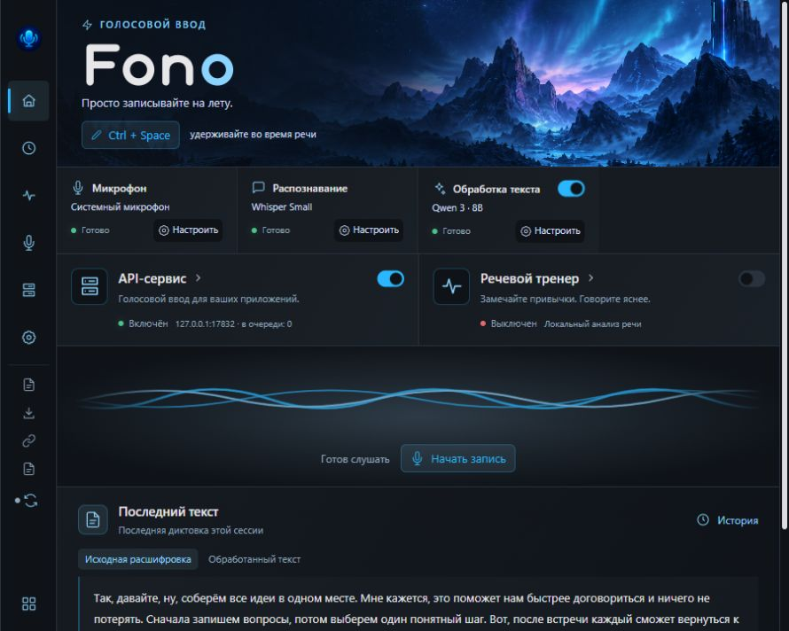
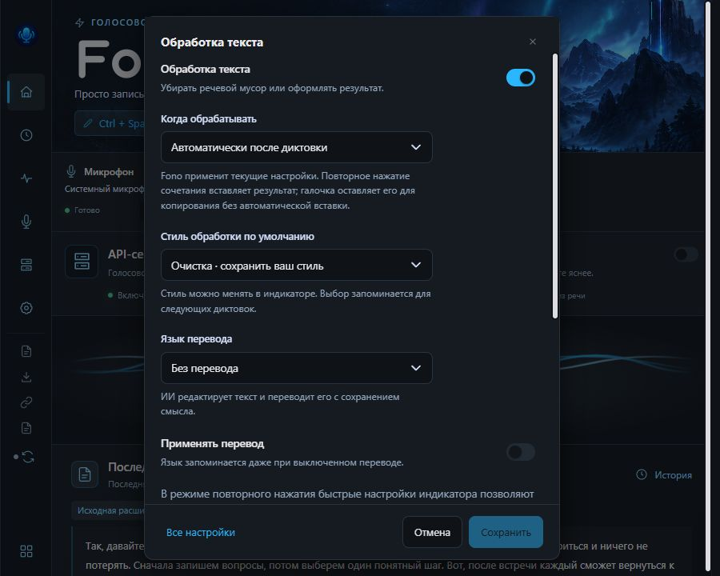
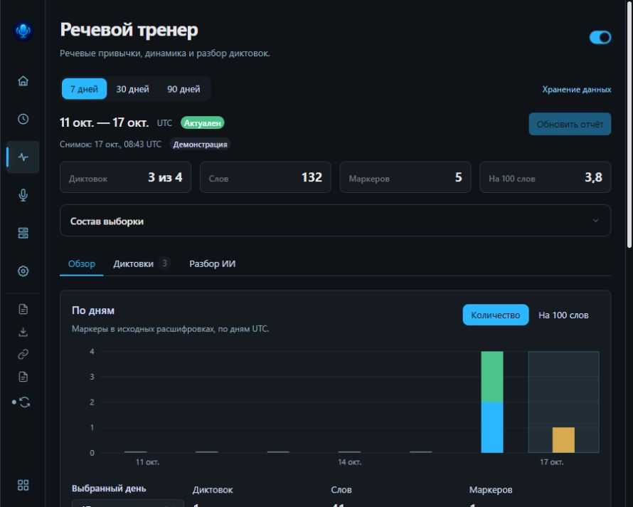
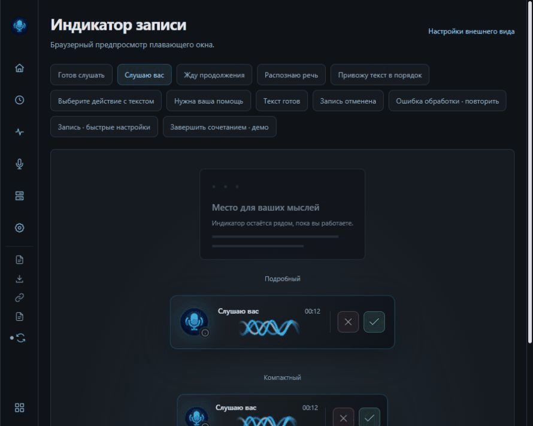

# Fono

[English](README.md) · [Скачать для Windows x64](https://github.com/whitewolf06/fono/releases/latest) · [Документация](docs/README.md)

Голосовой ввод для Windows с локальным распознаванием. Продиктуйте текст в
нужное поле, оставьте исходную расшифровку или примените обработку и перевод
через выбранное подключение к ИИ.

## Возможности

- Диктовка при удержании горячей клавиши или между двумя нажатиями.
- Плавающий индикатор с состоянием, отменой, принятием и копированием.
- Локальные Whisper-модели, Auto/CPU/CUDA/Vulkan и отдельные GPU workers.
- Очистка, оформление, задача, деловой стиль и собственные инструкции.
  В режиме повторного нажатия стиль и язык можно менять в индикаторе во время записи.
- Личный словарь, история с параметрами сессии и речевой тренер для анализа
  слов-паразитов, повторов и самопоправок в сохранившихся записях.
- Локальный REST API транскрибации и ограниченные голосовые команды с подтверждением.
- Раздельные настройки истории и аналитики. Ключи подключений хранятся в
  Windows Credential Manager. Распознавание работает на устройстве; обработка
  отправляет текст в выбранное подключение. LM Studio можно использовать локально.

Интерфейс сейчас на русском. WakeWord выключен, экспериментальный режим
«На лету» скрыт. Обычная диктовка распознаёт речь после завершения записи.

Настройки обработки, тренер и индикатор

Это рабочий Vue-интерфейс с демонстрационными данными. GIF собран из управляемых
состояний browser preview; длительность кадров не измеряет скорость распознавания.
Настоящий микрофон и внешние поля при съёмке не использовались.
[Как сделаны иллюстрации](docs/assets/README.md).

## Установка

Скачайте Windows x64 installer из [GitHub Releases](https://github.com/whitewolf06/fono/releases/latest).
Выберите микрофон, загрузите Whisper-модель и настройте горячую клавишу.
Для первого запуска можно выбрать CPU. Обработка и перевод включаются отдельно.
Автоматический режим и выбор действия после записи описаны в [руководстве](docs/user-guide.md).

Установленный Fono проверяет подписанный канал обновлений вручную или по
включённому пользователем расписанию. Проверка не запускает установку.
Изменения в ветке разработки не означают публикацию нового выпуска.

## Минимальная CPU-сборка

**Текущее ограничение исходной сборки:** `npm ci` пока требует доступ на чтение
`@whitelife-core/ui-kit@0.6.0` в GitHub Packages. Токен хранится в пользовательской
конфигурации npm, вне Git. Открытие этой зависимости ведётся в OSS-02.

1. Подготовьте Windows x64, Node.js 22, закреплённый Rust, MSVC C++ Build Tools
   и Windows SDK, CMake, LLVM/libclang, PowerShell 7, Python 3.12+, WebView2 и curl.exe.
2. Клонируйте `https://github.com/whitewolf06/fono.git` и откройте каталог проекта.
3. Выполните `npm ci` с описанным выше доступом к пакету.
4. Запустите `npm run dev:cpu`. Bootstrap проверит хэши speech-VAD ресурсов;
   распознавание использует embedded CPU Whisper. CUDA/Vulkan SDK и GPU workers не нужны.
5. Выберите небольшую Whisper-модель, Auto или CPU. Для первой проверки
   выключите обработку и перевод.
6. Откройте своё текстовое поле и проверьте диктовку. Это настоящее приложение;
   отдельный debug-профиль изолирует данные и блокирует реальные credentials/автозапуск.

Для работы только над интерфейсом: `npm run dev:ui`, затем
`http://127.0.0.1:1420/v3.html`. В браузере работают mock-порты и демоданные.
Подробности окружения, GPU и упаковки — в [development.md](docs/development.md).

## Замер распознавания

Пока есть один фиксированный CPU smoke-набор: Whisper tiny, 8 потоков,
debug-сборка, Intel i5-12600KF, 20 публичных RU/EN реплик FLEURS,
235,36 секунды аудио и 450 эталонных слов.

| Модель / backend                       | Прогретый inference |   RTF |    WER |
| -------------------------------------- | ------------------: | ----: | -----: |
| Whisper tiny / CPU, текущий FIR replay |    25,19 с суммарно | 0,107 | 19,56% |

RTF — секунды inference на секунду аудио. Время не включает загрузку модели,
VAD, ресемплинг, LLM и вставку. WAV восстановлены из 16 до 48 кГц и снова
понижены; это не настоящая широкополосная запись. Сравнение других моделей,
ускорителей и задержки всей диктовки требует отдельных замеров.

Строгий критерий ресемплера «WER не хуже» пока не выполнен: старый путь в том
же прогоне даёт 18,89%, разница +0,67 п.п. [Исходные результаты](docs/evidence/stage2-stt-quality-final.json)
и [ограничения измерения](docs/improvement-stage-2.md) сохранены открыто.

## Разработка и помощь

[Как внести вклад](CONTRIBUTING.md), [проверки](docs/testing.md),
[статус и оставшаяся приёмка](docs/STATUS.md), [архитектура](docs/architecture.md)
и [ADR](docs/adr/README.md). Для уязвимостей используйте [приватный контакт](SECURITY.md).
Не публикуйте ключи, личные записи и диктовки в issues.

Собственный код и документация распространяются по [MIT](LICENSE).
Для названия и графики действуют [отдельные условия](docs/brand-assets.md).
Библиотеки и модели сохраняют свои лицензии: [уведомления](THIRD_PARTY_NOTICES.md).
