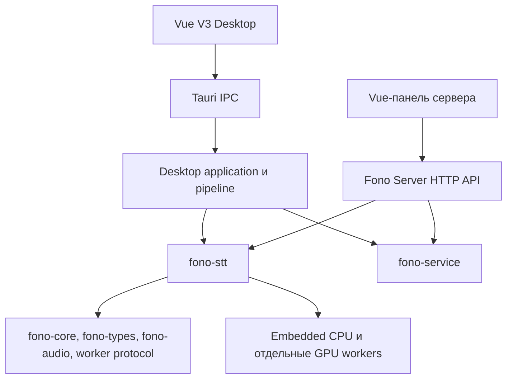

# Архитектура Fono

Fono состоит из Windows-приложения для диктовки и самостоятельного сервера
распознавания. Desktop работает локально либо отправляет аудио в Fono Server.
Сервер работает без Tauri и пользовательского desktop-профиля.

## Приложения и общее ядро

Корневой Cargo workspace объединяет `src-tauri/`, `crates/*` и `apps/*`.
Общие зависимости, lockfile, toolchain и профили сборки находятся в корне.
C++ Vulkan worker и самостоятельный `tools/fono-setup` исключены из workspace.

| Компонент                                   | Ответственность                                                                |
| ------------------------------------------- | ------------------------------------------------------------------------------ |
| `src-tauri/`                                | Tauri, Windows-интеграции, пользовательские сценарии, настройки и история      |
| `apps/fono-server/`                         | CLI, конфигурация, серверный runtime, авторизация и HTTP API                   |
| `fono-core`                                 | Координатор операций, отмена и владение ресурсами                              |
| `fono-types`                                | Идентификаторы моделей, результаты, транспортные контракты и стабильные ошибки |
| `fono-audio`                                | Общий AudioHub, ограниченные подписки и речевой VAD                            |
| `fono-stt`                                  | STT, модели, remote-клиент, worker lifecycle, пул и планировщики               |
| `fono-service`                              | Приём аудио, задания, экспорт и общие HTTP-маршруты                            |
| `fono-stt-protocol`                         | Сообщения и параметры распознавания worker                                     |
| `fono-stt-worker`, `fono-stt-vulkan-worker` | Rust CUDA worker и C++/CMake Vulkan worker                                     |
| `fono-wake`                                 | Optional-контур legacy WakeWord                                                |

Общие crates не зависят от Tauri или приложений. `fono-types` не владеет
Tokio runtime и native inference. Допустимые направления зависимостей проверяет
`scripts/check-crate-boundaries.mjs`, включая условные и транзитивные связи.

## Desktop и сервер

`src/v3/main.ts` выбирает native или browser mock runtime и внедряет порты.
Native composition root `app_runtime.rs` создаёт AudioHub, Pipeline, историю,
hotkeys, overlay, сервисы моделей и обновлений до открытия окон.
Его shutdown останавливает владельцев ресурсов.

В Desktop сценарии находятся в `application/`, координация диктовки —
в `pipeline/`, адаптеры оборудования и ОС — в `audio/`, `stt/`, `injection/`.
LLM-клиент и составитель инструкций остаются в `src-tauri/src/llm/`.

Fono Server внедряет собственные пути, activity guards, токены и listener.
Он использует ModelPool и очереди CPU/GPU. Панель собирается из
`src/v3/server.ts`; её статические ресурсы встроены в серверный бинарник.
Настройки, история и credentials Desktop серверу не нужны.

Локальный HTTP API Desktop требует локальный источник STT; пересылки его
запросов на Fono Server нет. Загрузка файлов из самого Desktop уже может
использовать remote batch-клиент. Контракты: [API](api.md),
[удалённое распознавание](remote-recognizer.md), [сервер](server.md).

## Операция диктовки

Обычный путь: ограниченная запись → речевой VAD → STT → необязательная
обработка и перевод → личный словарь → результат → вставка или решение
пользователя. Отсутствие речи завершается до STT, истории и вставки.
Режимы hotkey `hold` и `toggle` используют этот же путь.

Операция получает собственный ID, снимок настроек и cancellation.
Повторный Stop ожидает её результат. Запоздалые Release, таймеры и ответы
не завершают следующую сессию; Cancel запрещает позднюю публикацию и вставку.
Отмена ожидания не завершает native inference: фоновая работа удерживает
admission lease и ресурсы до фактического окончания cleanup.

Ручная обработка и ошибка ИИ сохраняют исходный текст для следующего действия.
Выбор обработки в overlay сначала сохраняется и затем применяется к указанной
сессии. Перед Stop завершается сохранение последнего выбора. Принятую сессию
архивируют один раз; последний результат существует независимо от истории.
`raw` без перевода обходит LLM.

Поле для вставки фиксируется при старте. Смена поля, неопределённый результат
или частичная отправка оставляют текст для копирования и блокируют повторную
автоматическую отправку. Native overlay имеет `focus: false` и
`focusable: false`. Эти правила сохраняются при смене backend и рефакторинге.

## Данные и приватность

| Данные                         | Хранение и граница                                                                  |
| ------------------------------ | ----------------------------------------------------------------------------------- |
| Настройки Desktop              | `settings.json`, сериализованная атомарная запись с восстановлением                 |
| История и аналитика            | Локальная `dictation-history.sqlite3`, транзакции и снимок чтения в памяти          |
| Последний результат            | Состояние текущей сессии, отдельно от архива                                        |
| Remote STT и LLM-ключи Desktop | Windows Credential Manager; renderer получает признаки наличия                      |
| Токен локального Desktop API   | Отдельный `api-token.txt`, вне DTO настроек                                         |
| Ключи Fono Server              | Файл проверяемых хешей с ограниченными правами, scope и отзывом                     |
| Browser mock                   | Разрешённые демонастройки; тексты, ключи и словарь не сохраняются в browser storage |

История мигрирует из проверенного legacy JSON один раз. Удаление, retention
и отзыв согласия очищают также прежние копии, чтобы текст не вернулся при
импорте. Ошибка privacy-записи блокирует выдачу старого кэша до успешного
повтора. Хранение итогового текста и аналитики настраивается раздельно.
SQLite использует `secure_delete`, DELETE journal и FULL synchronous;
это не шифрование и не гарантия стирания системных резервных копий.

Remote STT отправляет аудио выбранному серверу. Обработка выбранным внешним
LLM отправляет ему текст. Диагностический экспорт и серверная телеметрия
ограничены техническими полями: без текстов, аудио, токенов, промптов,
пользовательских путей и сырых ошибок. Backend, модель и длительности
в истории относятся к конкретной сессии; неизвестные значения не выдумываются.

## Действующие ограничения

Классическая диктовка доступна, сохранённый `live` нормализуется в `standard`.
Legacy-мастер произвольной wake-фразы выключен; фраза и профиль сохраняются.
Отдельная opt-in Лира beta использует фиксированную фразу «Привет, Лира»,
общий AudioHub и проверяемый комплект runtime/моделей. Она не открывает legacy gate.

Общие crates и успешная Linux-компиляция не означают готовность
Linux/macOS Desktop. GPU-изоляция, модельные ограничения и память описаны
в [STT](stt.md); правила изменений — в [правилах кода](code-rules.md).
